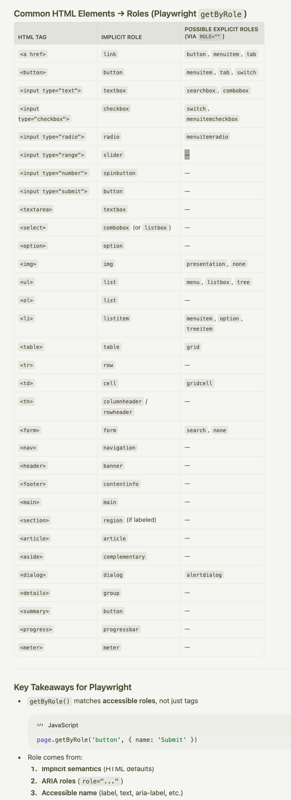

# Playwright Locator (80%)

#### Locator Priority -> Which One to Use First
When choosing a locator, Playwright recommends this priority. Start from the top. Use the first one that works for your element.

**1st -> getByRole()** — Most resilient. Doesn't break when CSS or text changes.

**2nd -> getByTestId()** — Very stable. Created specifically for automation.

**3rd -> getByText()** — Human-readable. Breaks only if visible text changes.

**4th -> getByPlaceholder()** — Good for form inputs.

**5th -> getByLabel()** — Finds inputs by their `<label>` text.

**6th -> CSS Selectors** — Fallback. Fragile when IDs or classes change.

**7th -> XPath** — Last resort. Brittle and hard to read. Avoid.

```
These locators follows the concept of ARIA concept.(every modern browser have to 
support the aria things ( acceessbiloty things and dev html they have to follow
the rules))
```

| <u>**Priority**</u> | <u>**Locator**</u> | <u>**Code Example**</u> | <u>**HTML Target**</u> | <u>**When to Use**</u> |
| ----- | ----- | ----- | ----- | ----- |
| <u>**1**</u> | `<u>getByRole</u>` | `page.getByRole('button', { name: 'Submit' })`<br>`page.getByRole('heading', { level: 1 })`<br>`page.getByRole('checkbox', { checked: true })` | `<u><button>Submit</button></u>` | <u>Best for accessibility. Works with ARIA roles. First choice always.</u> |
| <u>**2**</u> | `<u>getByTestId</u>` | `page.getByTestId('login-btn')`<br>`page.getByTestId('user-card')` | `<u><button data-testid="login-btn"></u>` | <u>Most stable. Add custom test IDs for reliable automation.</u> |
| <u>**3**</u> | `<u>getByText</u>` | `page.getByText('Welcome back')`<br>`page.getByText('Login', { exact: true })`<br>`page.getByText(/welcome/i)` | `<u><span>Welcome back</span></u>` | <u>Match visible text content. Supports regex.</u> |
| <u>**4**</u> | `<u>getByLabel</u>` | `page.getByLabel('Email')`<br>`page.getByLabel('Password')` | `<u><label>Email <input/></label></u>` | <u>Form inputs with associated labels.</u> |
| <u>**5**</u> | `<u>getByPlaceholder</u>` | `page.getByPlaceholder('Enter email')`<br>`page.getByPlaceholder(/search/i)` | `<u><input placeholder="Enter email"></u>` | <u>Inputs with placeholder text, no label available.</u> |
| <u>**6**</u> | `<u>getByAltText</u>` | `page.getByAltText('Company Logo')`<br>`page.getByAltText(/profile/i)` | `<u></u>` | <u>Images with alt text.</u> |
| <u>**7**</u> | `<u>getByTitle</u>` | `page.getByTitle('Close dialog')`<br>`page.getByTitle(/settings/i)` | `<u><button title="Close dialog"></u>` | <u>Elements with title attribute.</u> |

**getByRole()**

`getByRole()` finds elements by their **ARIA role** -> the accessibility role that tells screen readers what an element IS. A button is a `button`, an input is a `textbox`, a link is a `link`. These roles are built into HTML -> you don't need to add them manually.

[developer.mozilla.org/en-US/docs/Web/Accessibility/ARIA](https://developer.mozilla.org/en-US/docs/Web/Accessibility/ARIA)

This is Playwright's **#1 RECOMMENDED** locator strategy. Why? Because ARIA roles are tied to WHAT the element IS, not how it looks. When the design team changes `class="primary-btn"` to `class="main-button"`, the role `button` stays the same. Your test doesn't break.

`<button role=button />`

```
getByRole(role: 
"alert" | 
"alertdialog" | 
"application" | "article" | 
"banner" | "blockquote" | "button" | "caption" | "cell" 
| "checkbox" | "code" | "columnheader" | "combobox" | 
"complementary" | "contentinfo" | "definition" | "deletion" 
| "dialog" | "directory" | "document" | "emphasis" | "feed" | 
"figure" | "form" | "generic" | "grid" | "gridcell" | "group" 
| "heading" | "img" | "insertion" | "link" | "list" | "listbox" | 
"listitem" | "log" | "main" | "marquee" | "math" | "meter" | 
"menu" | "menubar" | "menuitem" | "menuitemcheckbox" | "menuitemradio" |
 "navigation" | "none" | "note" | "option" | "paragraph" | "presentation" | 
 "progressbar" | "radio" | "radiogroup" | "region" | "row" |
  "rowgroup" | "rowheader" | "scrollbar" | "search" | "searchbox" |
   "separator" | "slider" | "spinbutton" | "status" | "strong" | 
   "subscript" | "superscript" | "switch" | "tab" | "table" | 
   "tablist" | "tabpanel" | "term" | "textbox" | "time" | 
   "timer" | "toolbar" | "tooltip" | "tree" | "treegrid" | "treeitem", 
   options?: {
```



```
import { test, expect } from "@playwright/test";

test("find elements by ARIA role", async ({ page }) => {
    await page.goto("https://app.vwo.com/login");

    // Find heading
    let heading = await page.getByRole("heading", { name: "Login" }).textContent();
    console.log("Heading:", heading);**

    // Find textbox (input) by its label
    await page.getByRole("textbox", { name: "Email" })**.fill("dev@test.com");**
    console.log("Filled email textbox ✅");

    // Find checkbox
    await page.getByRole("checkbox", { name: "Remember me" }).check();
    console.log("Checked 'Remember me' ✅");

    // Find button
    await page.getByRole("button", { name: "Sign In" })**.click();**
    console.log("Clicked 'Sign In' button ✅");

    // Find link
    await page.getByRole("link", { name: "Forgot Password" })**.click();**
    console.log("Clicked 'Forgot Password' link ✅");
```
