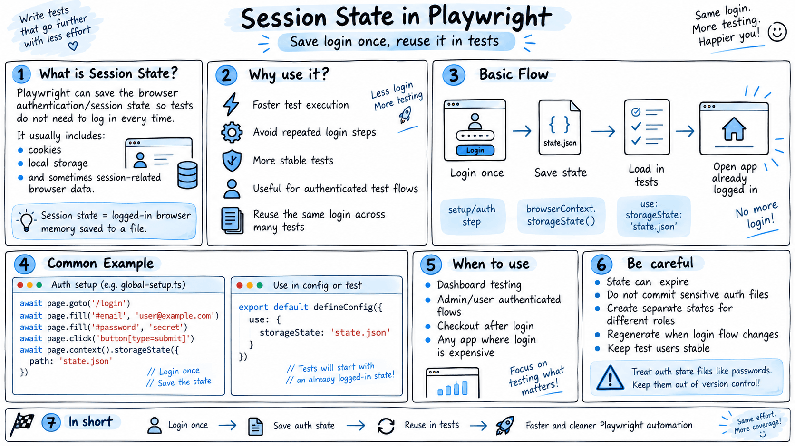

# Session State in Playwright
- Session state is the data that keeps a user "logged in" .
- typically a session token in a **cookie** or **localStorage**. 
- When you login, the server creates a session and sends back a token.
- Your browser stores it and includes it in every subsequent request.
- Testing session state means verifying: **sessions persist across pages**, sessions **survive page refresh, sessions expire when they should,** and sessions are destroyed on logout. 
- **Storage state is Playwright's way of SAVING a login session to a JSON file and REUSING it later.** Instead of logging in before every test (slow), you login ONCE, save everything (cookies + localStorage), and load it in all future tests.



**If you have 50 tests, that's 50 login operations saved. Massive time saver.**

> 12000

login 4000 -> we can save lot of time. 


> 3-4 hours -> in that time, we can complete our testcases - 

VWO cookie is 1 hour to 24 hours ->


[www.npmjs.com/package/dotenv](https://www.npmjs.com/package/dotenv) 


```
npx tsx tests/04_Session_Storage/231_SessionStorage.ts 2>&1 | tail -30
```
```
npx playwright test tests/04_Session_Storage/232_TestWingify.spec.ts --reporter=list
```
