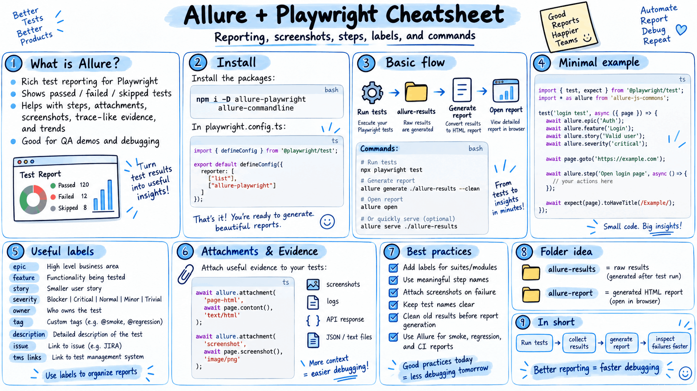

Allure Report

[allurereport.org/docs/playwright/](https://allurereport.org/docs/playwright/) 

## Getting started with Allure Playwright
- Make sure [Node.js](https://nodejs.org/) is installed.
- **npm install --save-dev @playwright/test allure-playwright**
- In the `playwright.config.ts add this line``**["allure-playwright"]]**` 
- Make sure that before running this command - npm i allure-commandline (one time)
- To see the Results -> **allure serve allure-results/**
- Reference -> [allurereport.org/docs/playwright/](https://allurereport.org/docs/playwright/) 

/// if allure is not recognized
> npm i -g allure-commandline

 want to add a custom log 

 **await allure.attachment**("Text file", "This is the file content.", ContentType.TEXT);

---

- 95% - Default Playwright Reporter
- 2-3% - Allure Reporter - HTML
- 1% Custom Solution -> Create by using AI or You can reuse **CustomTTA Reporter.** 

[github.com/PramodDutta/AdvancePlaywrightFramework2x/blob/main/src/utils/CustomReporter.ts](https://github.com/PramodDutta/AdvancePlaywrightFramework2x/blob/main/src/utils/CustomReporter.ts) 
