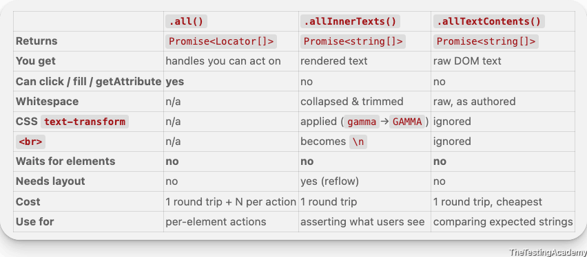

# **Multiple Element & Web Tables Support in** Playwright
```
import { test, expect, Locator } from '@playwright/test';
test('Basic verify how to handle multiple elements ', async ({ page }) => {
    await page.goto("https://app.thetestingacademy.com/playwright/multiple_element_filter");
    const rightPanelLinksTexts: Locator[] =  await page.locator('a.list-group-item').;
    console.log(rightPanelLinksTexts.length);
    for (const link of rightPanelLinksTexts) {
        console.log(await link.getAttribute('href'));
    }

    await page.pause();
});
```


---



---

## Locator Collection Patterns
- `page.locator('a.list-group-item').allInnerTexts()`  returns the text content for every matching element as a `string[]` . Use this when you need to inspect or compare displayed text before choosing an action.
- `page.getByText(linkText).first().click()`  clicks the first element matching dynamic text from the collected list. The `.first()`  call avoids strict-mode issues when more than one element has the same text.
- `page.locator('a.list-group-item').all()`  returns an array of `Locator`  objects. Use this when each matching element still needs locator actions or attribute reads, such as `getAttribute('href')` .


---

## How to Debug Playwright Code ?
1. await page.pause()
2. Debug will open and use the next command to check


---

# 
