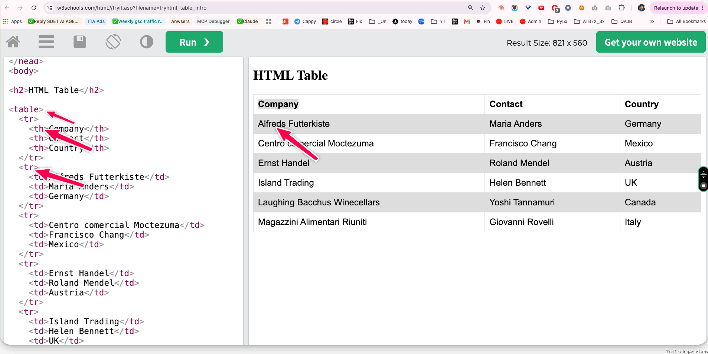
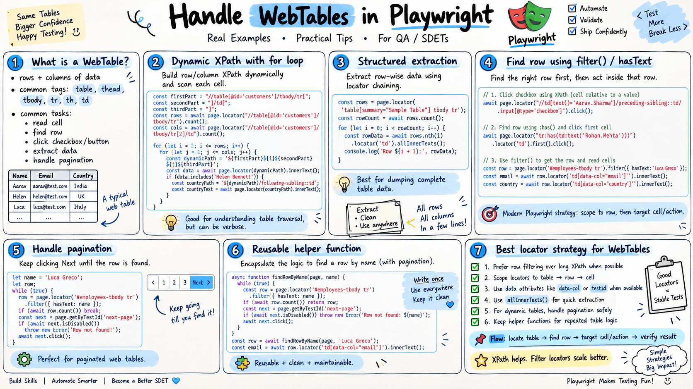
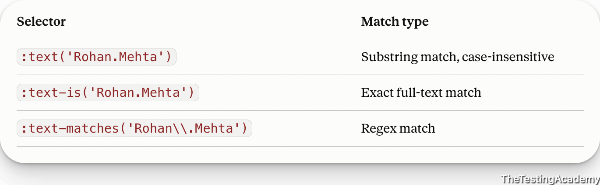
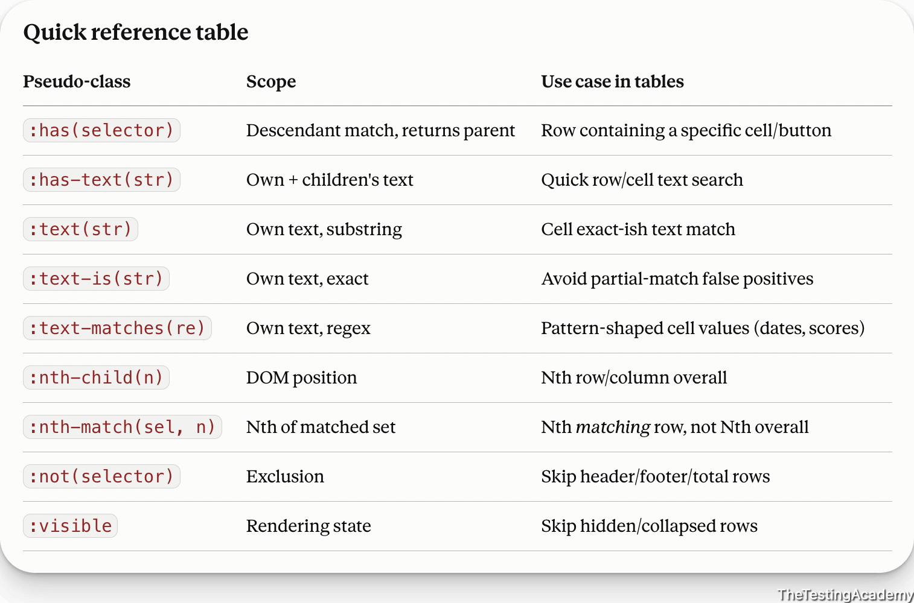

# Web Tables
HTML tables allow web developers to arrange data into rows and columns.

[www.w3schools.com/htmL//tryit.asp?filename=tryhtml_table_intro](https://www.w3schools.com/htmL//tryit.asp?filename=tryhtml_table_intro) 



- **Count rows and columns before iterating through a table.**
- **Build dynamic XPath expressions** when demonstrating row and column indexes.
- Use XPath axes such as `following-sibling::td`  to read related cells in the same row.
- Prefer Playwright locators like `page.locator('table tbody tr', { hasText: '...' })`  for readable row targeting.
- Use `locator('td').nth(index)`  or `allInnerTexts()`  to extract individual cells or full row data.
- Remember that **XPath table indexes are one-based,** while Playwright `nth()`  indexes are zero-based.
---

### Project - Webtable Project
> Zeta

URL - > [awesomeqa.com/webtable.html](https://awesomeqa.com/webtable.html) 

**Objective** :  To find the Helen Bankett first in the web table, and following the web table, please find which country she belongs to.

**Concept** -  following sibling, Dynamic XPath creation. -> Playwright Locator.


```
//table[@id="customers"]
//table[@id="customers"]/tbody/tr -> Rows (in heading) -> 7

Helen -> **//table[@id="customers"]/tbody/tr[5]/td[2]

//table[@id="customers"]/tbody/tr[5]/td[2]/preceding-sibling::td -> Company
//table[@id="customers"]/tbody/tr[5]/td[2]/following-sibling::td -> Country**
```



---

> 26th Sept 2026

# WebTable Part 2
## Filter & hasCSS Selector 


**Filter :**   based on the number of locators, it will allow you to find a particular locator: 

- which has a text
- which does not have a text
- which has certain attributes
- which has a certain locator
```
import { test, expect, Locator } from '@playwright/test';

test('Verify the TestCase', async ({ page }) => {
   await page.goto("https://app.thetestingacademy.com/playwright/multiple_element_filter");

   const forgottenPasswordLink = page.locator('a.list-group-item')
      .filter({ hasText : 'Forgotten Password'});
   await forgottenPasswordLink.click();

   const privacyLink = page.locator('footer a')
   .filter(
      { hasText: 'Privacy Policy' }
   );

   await expect(privacyLink).toHaveAttribute('href', '#privacy-policy');

   await page.pause();
});
```





---

## Project :  Pagination in WebTable
Objective : Find the on this page - [app.thetestingacademy.com/playwright/tables/webtable](https://app.thetestingacademy.com/playwright/tables/webtable) 

find the Luca Greco in which country he is present and email ID.


---

> 
