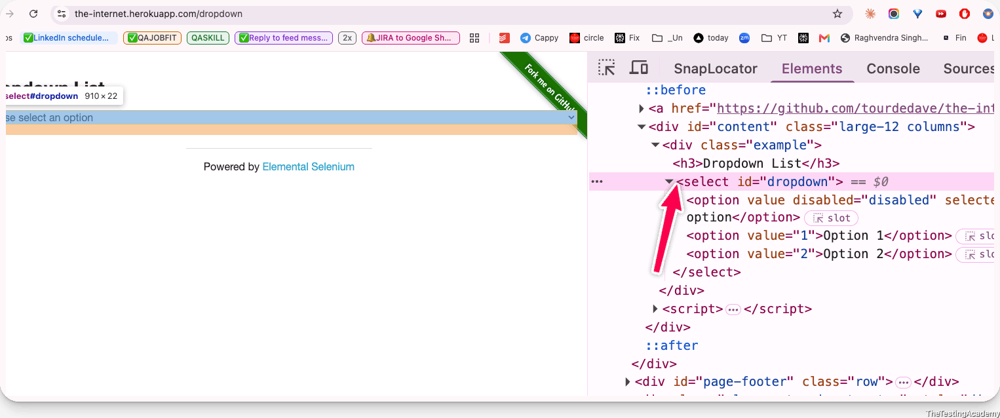
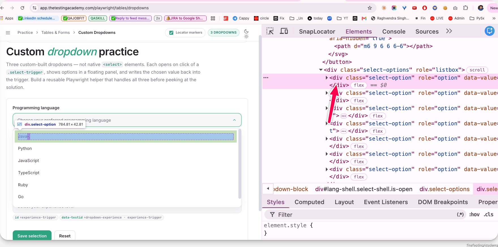
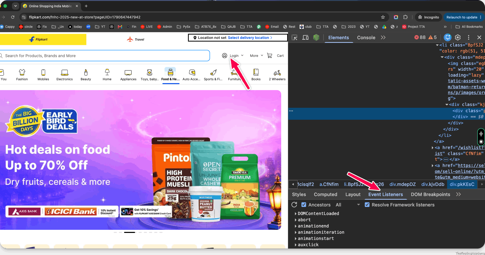

#  Web Select, Handling Frame/ Iframe and Windows
## Select / DropDown
Dropdowns or selects are mostly used when we have multiple options for a single question or single thing that we want to select, and people can select the options. They can select one option or two options. They can be customized, they can come after some time, they can be grouped together, and people can select multiple options also 

Simple Dropdown - [the-internet.herokuapp.com/dropdown](https://the-internet.herokuapp.com/dropdown) 

Custom DropDown - [app.thetestingacademy.com/playwright/tables/dropdowns](https://app.thetestingacademy.com/playwright/tables/dropdowns) 

Advance 5+ DropDown -> [app.thetestingacademy.com/playwright/tables/select-boxes](https://app.thetestingacademy.com/playwright/tables/select-boxes) 

## Select / Dropdown in Playwright
| Term | Meaning | Playwright action |
| ----- | ----- | ----- |
| **Select** | An HTML `<select>` element containing multiple `<option>` choices. | Use `locator.selectOption()`  |
| **Dropdown** | A UI control that opens a list of choices; it may be a native `<select>` or a custom component. | Use `selectOption()` for native dropdowns, or `click()` for custom dropdowns. |
### Native HTML dropdown
```
<select id="country">
  <option value="in">India</option>
  <option value="us">United States</option>
</select>

const countryDropdown = page.locator('#country');

// Select using value
await countryDropdown.selectOption('in');

// Select using visible text
await countryDropdown.selectOption({ label: 'India' });
```


### Custom dropdown
A custom dropdown may be created using `<button>`, `<div>`, `<li>`, or ARIA roles instead of a `<select>` element




```
await page.getByRole('combobox', { name: 'Country' }).click();
await page.getByRole('option', { name: 'India' }).click();
```
1. Open the DropDown
2. Select by Text or Role. 




- mouse*
mouserHover, over down... - delete them 
- 
---

```
import { test, expect, Locator } from '@playwright/test';

test('Verify Advance Custom DropDowns', async ({ page }) => {
   await page.goto('https://app.thetestingacademy.com/playwright/tables/select-boxes');

       // ① Single — searchable

   await page.locator('#rs-single').click();
   await page.getByText("Cypress").click()

     // ②  Multi — chips with remove
   await page.locator("#rs-multi").click();
   await page.getByText("Pytest", { exact: true }).click();
   await page.getByText("JUnit", { exact: true }).click();
   await page.keyboard.press("Escape");


    // ③ Creatable multi — type and Enter
    await page.locator("#rs-creatable").click();
    await page.getByText("api-testing", { exact: true }).click();
    await page.getByText("security", { exact: true }).click();
    await page.keyboard.press("Escape");


    // ⑤ Async — fetched on type


    await page.locator("#rs-async").click();
    await page.getByTestId('rs-async-input').fill('de');
    await expect(page.getByTestId('rs-async-menu')).toContainText('Delhi');
    await page.getByRole('option',{ name: "Delhi", exact :true},).click();

   await page.pause();
});
```
---
