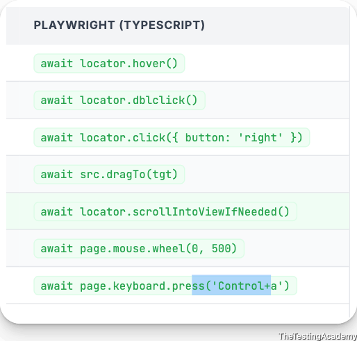
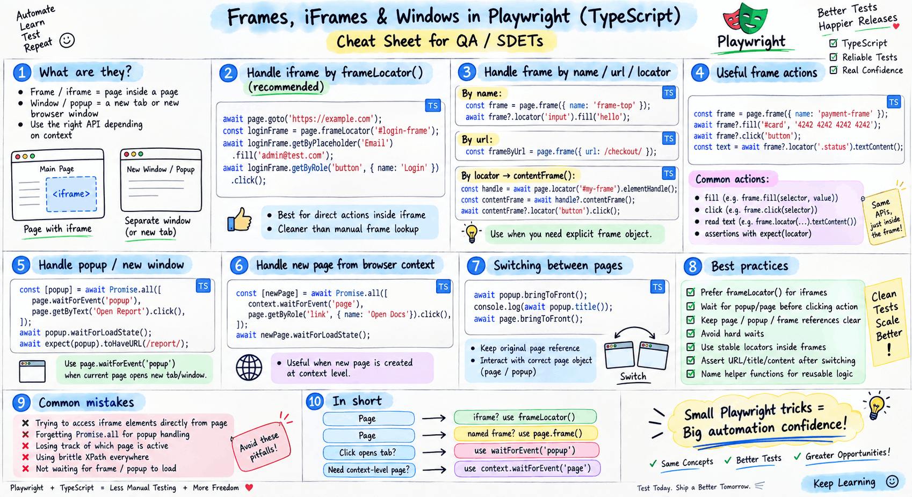

# Handling Frame/ Iframe
## **What is an iframe?**
An iframe (`<iframe>`) embeds another HTML page inside the current page. It has its own DOM, its own CSS, its own JavaScript , completely isolated from the parent page.

Common iframe examples: payment forms (Stripe, Razorpay), embedded YouTube videos, Google Maps, reCAPTCHA, social media widgets, and third-party chat widgets.


```
<!-- Main page -->
<h1>Payment Page</h1>
<p>Enter your card details below:</p>

<!-- iframe — another page embedded inside -->
<iframe src="https://payment-provider.com/form" id="payment-frame">
    <!-- Inside this iframe is a SEPARATE page with its own elements -->
    <!-- <input id="card-number" placeholder="Card Number" /> -->
    <!-- <button>Pay Now</button> -->
</iframe>
```
**here is no need to switch in Playwright** 


##  Frames
| Method | What It Does |
| ----- | ----- |
| `**page.frameLocator("#id")**`  | Access iframe (recommended) |
| `frame.locator("selector")`  | Find element inside iframe |
| `outer.frameLocator("#inner")`  | Access nested iframe |
| `page.frame({ name: "X" })`  | Older approach |
---

Coding Practice - [app.thetestingacademy.com/student/coding-practice](https://app.thetestingacademy.com/student/coding-practice) 

Selector - [qabattle.com/app/battles/selector-battle](https://qabattle.com/app/battles/selector-battle) 


---

## 🟩 Handle Keyboard and Mouse Events, JS Alerts
```
await page.keyboard.type('Hello World!');
await page.keyboard.press('ArrowLeft');
await page.keyboard.press('Shift+KeyA');

await keyboard.down(key);
```



---




---


