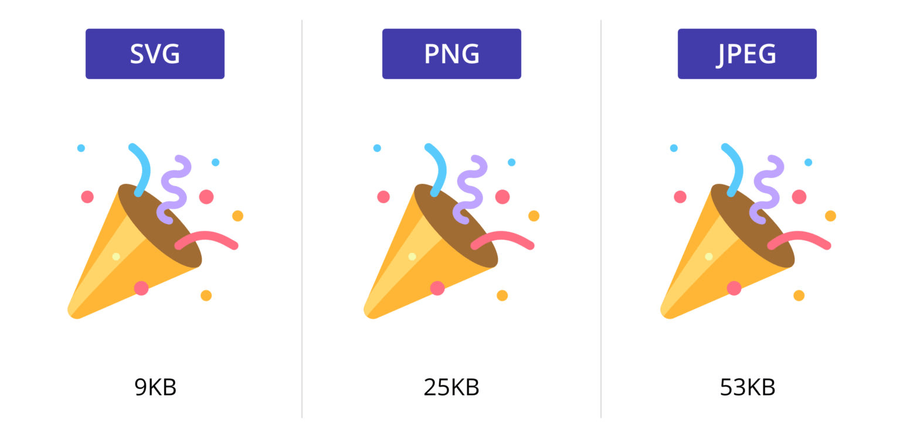
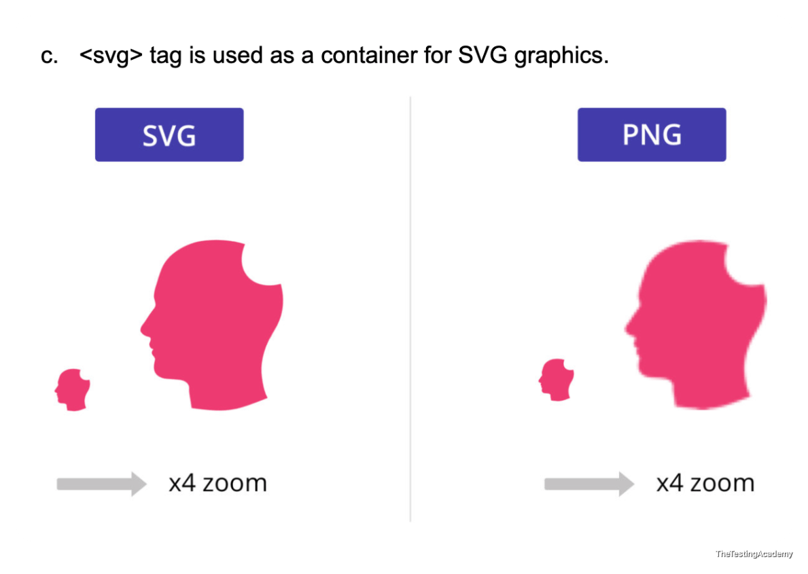

## Handle SVG & Shadow DOM, FIle Upload.
### SVG (Scalable Vector Graphics)
- [SVG defines vector-based graphics in XML](https://www.w3schools.com/graphics/svg_intro.asp), which can be directly embedded in HTML pages.
-  2D Vector Graphics This is created by using the XML tags.
-  there are very, very complex graphics. You can create faces, art, and many more things on the internet that are actually present with SVG 

### Key Points from W3Schools SVG Intro
- **SVG = Scalable Vector Graphics** — used to define vector-based graphics for the Web.
- SVG defines graphics in **XML format** — SVG files are pure XML.
- **Open standard** and a **W3C Recommendation** (SVG 1.0 → 4 Sep 2001, SVG 1.1 → 14 Jan 2003, SVG 1.1 Second Edition → 16 Aug 2011).
- **Scalable and zoomable** — graphics do NOT lose quality when zoomed or resized.
- Can be **printed with high quality at any resolution**.
- Supported by **all major browsers**.
- **Every element and attribute in SVG files can be animated.**
- SVG images can be **searched, indexed, scripted, and compressed**.
- **Integrates with other standards** — CSS, DOM, XSL and JavaScript.
- Can be **created and edited with any text editor** (or a drawing program like Inkscape).
- **Advantages over other formats (JPEG/GIF)** — editable as text, searchable/indexable, scalable, zoomable, resolution-independent, open standard, pure XML.
- **How it works** — SVG has elements and attributes for rectangles, circles, ellipses, lines, polygons, curves, and more; it also supports filter and blur effects, gradients, rotations, animations and JavaScript interactivity.
- A simple SVG document consists of the **`<svg>` root element plus several basic shape elements** that build a graphic together.
- **Prerequisite knowledge** — basic understanding of HTML and basic XML.

Reference - [w3schools.com/graphics/svg_intro.asp](https://www.w3schools.com/graphics/svg_intro.asp) 





```
<svg>, <g> , <circle> , <polygon> , <path>
<svg>
<g>
<path></path>
<path></path
</g>
</svg>
```

## How to handle SVG Elements in Playwright?
1. **XPATH**
    1. **name()** / **local-name()**

**PS. This is a normal image file with the svg extenstion it will be hanlded like an image.**

`` 

`<svg>` 

```
// Handle SVG elements with Playwright (TypeScript)
// ------------------------------------------------
// SVG nodes live in the SVG namespace, not HTML.
// CSS selectors work fine. XPath needs **name() / local-name()** because
// tag names are namespaced (e.g. svg:path).
// Common patterns: locate SVG, locate child shapes **(path**/rect/circle/g),
// click, hover, read attributes (d, fill, viewBox, stroke), assert state.
```
## Task - Search and Print the Titles of the macmins available in the flipkart. 
1. Navigate - [www.flipkart.com/search](https://www.flipkart.com/search) 
2. Search for the "macmini"
3. Print all the titles and prices. 
---

> npx playwright test tests/12_Handle_SVG/255_SVG_TestCase.spec.ts --debug
