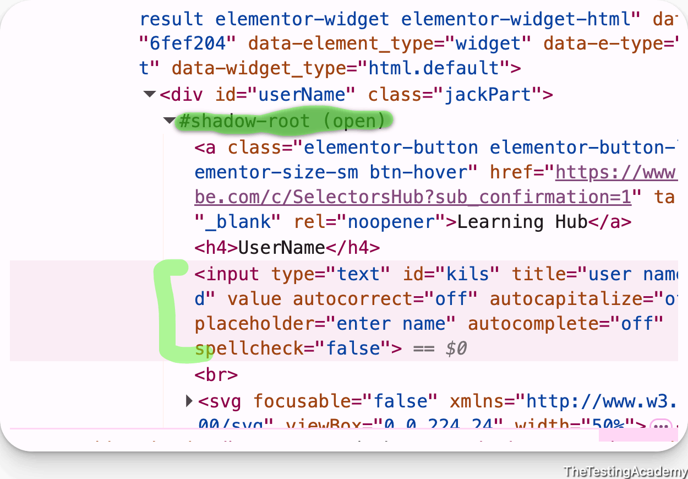
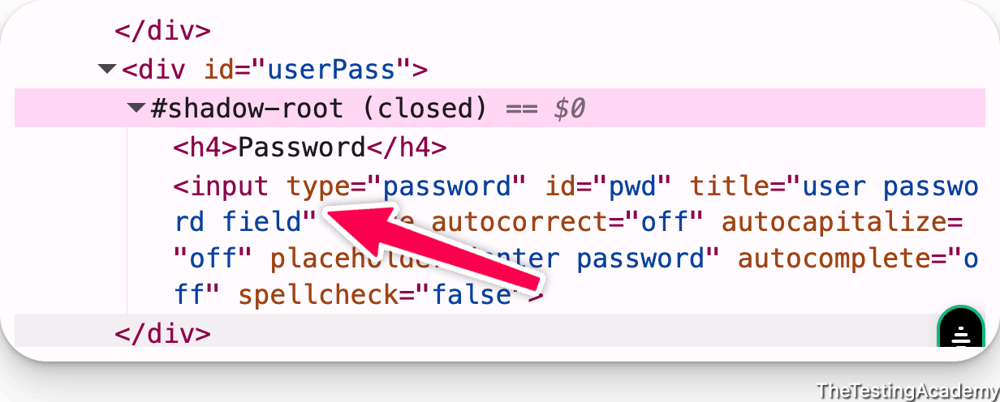
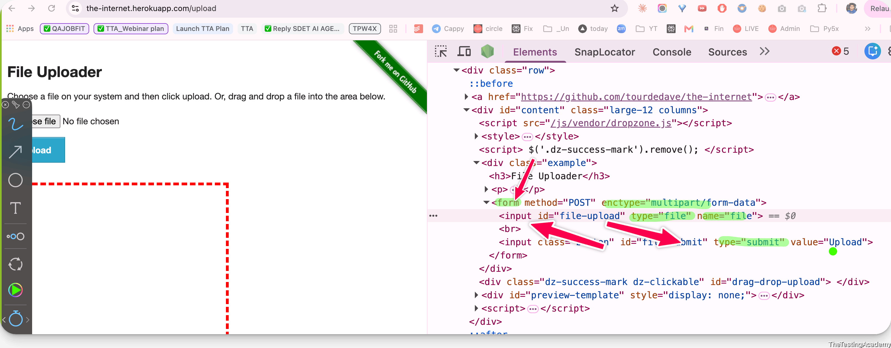
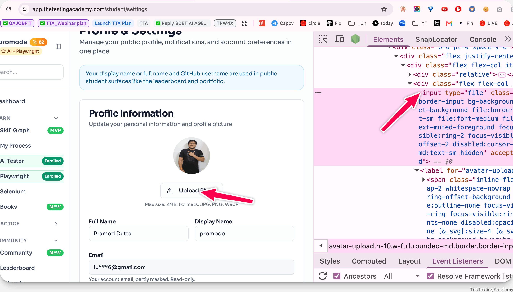

## Handling Shadow DOM, File Upload and Download


Shadow DOM is a web standard that offers a way to **encapsulate style and markup in web components.** 

[developer.mozilla.org/en-US/docs/Web/API/Web_components/Using_shadow_DOM](https://developer.mozilla.org/en-US/docs/Web/API/Web_components/Using_shadow_DOM) 




If the Shadow Root is closed, we will not be able to communicate.or intrect.




**File Upload**

 file upload is nothing but a mechanism where you can upload a file by using the input box 





P.S :  the problem with the network idle is that it will wait for all the requests or APIs to be finished, which will take a lot of time 




| Order | Result |
| ----- | ----- |
| <p>Listener </p><p>**before**</p><p> click</p> | caught `sample-download.txt` in **252ms** |
| Click, then listener immediately | caught it (got lucky) |
| Click, wait 3s, then listener | <p>**MISSED**</p><p>, event never replayed</p> |

**The reason:** `**waitForEvent**` **only sees events that fire while it's listening.** It does not replay history. The download event fires during the click, so a listener registered afterwards is racing it, and once the event has passed it is gone forever. Your test then sits until the timeout and fails with a misleading "waiting for event download".

My second probe is the honest version of that: with a 3-second gap it misses every time. The immediate-after case passing was luck, the event just hadn't landed yet in that run. That's the worst kind of bug, it passes on your laptop and fails on a slower CI box.

**What** `**Promise.all**` **actually does here**, and it's not parallelism:

```ts
const [staticDownload] = await Promise.all([
      page.waitForEvent('download'),            // ① runs first, registers the listener
      page.getByTestId('download-static').click()  // ② then the click fires the event
]);
```
Array elements evaluate top to bottom. `waitForEvent` is called first and returns a pending promise, which registers the listener _synchronously_. Only then is `click()` called. `Promise.all` just waits for both to settle. The ordering is doing the work, not the concurrency.

**The form Playwright now recommends** is the same thing, more plainly:

```ts
const downloadPromise = page.waitForEvent('download');   // register, don't await
await page.getByTestId('download-static').click();       // fire it
const download = await downloadPromise;                  // now collect

await download.saveAs('./out/' + download.suggestedFilename());
```
The missing `await` on line 1 is the whole trick. `await` there would block until a download happened, but nothing has clicked yet, so it would deadlock until timeout.

This is the identical shape as `page.once('dialog', ...)` in [254_JS_Alerts.spec.ts](https://tests/11_JS_Alerts/254_JS_Alerts.spec.ts): register the handler, then trigger. Worth teaching them as one rule, **subscribe before you trigger**, since it covers `download`, `dialog`, `popup`, `filechooser`, `request` and `response`.

One note on your line 16: `'./out/'` resolves against the working directory, not the spec. `path.join(__dirname, 'out', ...)` is the portable form, same point as 265.
