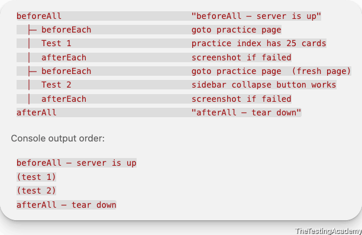
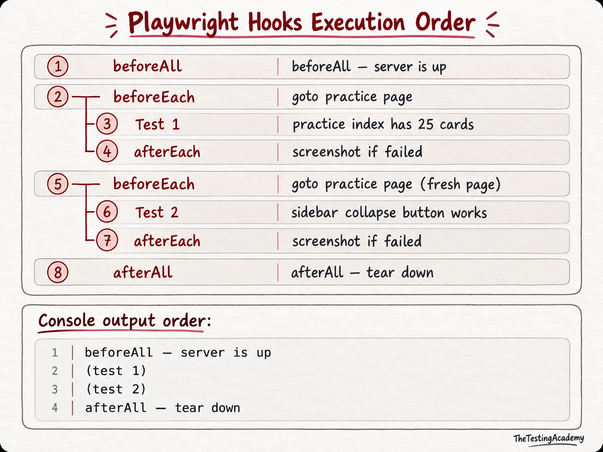

# Test Hooks
This module shows how Playwright tests can control setup, teardown, reporting context, and execution flow with hooks, annotations, steps, and grouped suites.

## Patterns Covered
- Use annotations inside tests when behavior depends on browser support, known defects, or expected failures.
- Use `test.step()`  to make reports easier to read without splitting one scenario into multiple tests.
- Use `beforeEach`  for repeated page setup and `beforeAll`  or `afterAll`  for worker-level setup and teardown.
- Use `afterEach`  with `testInfo.status`  and `testInfo.expectedStatus`  to collect artifacts only when a test ends unexpectedly.
- Use `test.describe.serial()`  only when tests must share ordering; keep independent tests outside serial groups.
[peter.sh/experiments/chromium-command-line-switches/](https://peter.sh/experiments/chromium-command-line-switches/) 

