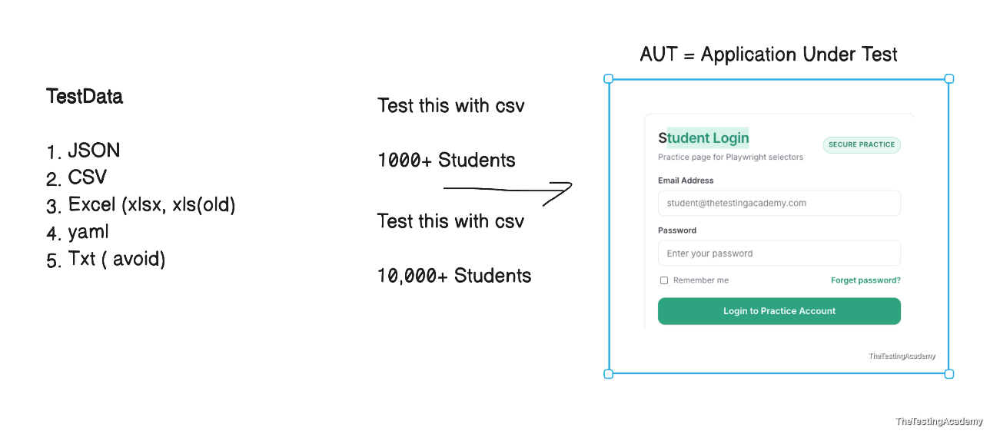
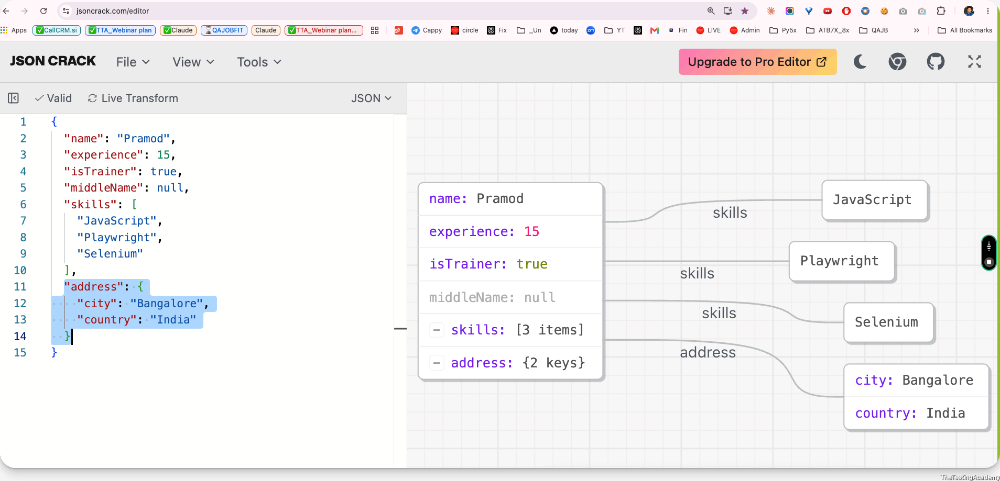
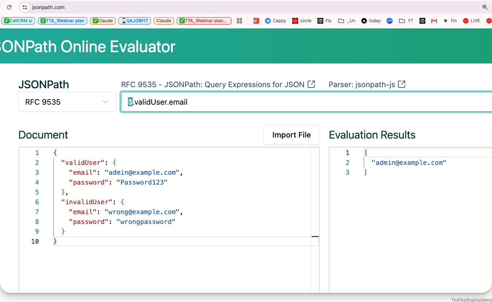
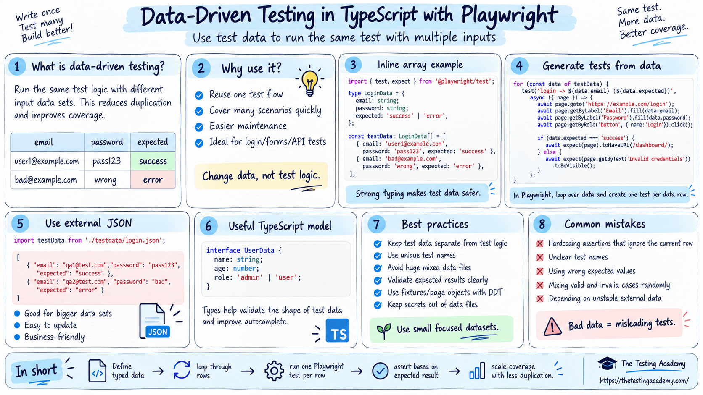

# Data-driven Testing
- Data-driven testing is a way of testing where **you have an external data source and the application under test.** 
- You basically use the external files or external test data to test the application under test multiple times with this.




---

## **JSON** 
- **JSON** stands for **JavaScript Object Notation**.
- It is a lightweight format used to store and transfer data between applications.
```
{
  "name": "Pramod",
  "role": "QA Engineer",
  "experience": 15
}
```
**JSON is commonly used in:**

- API
- Configuration files
- Test data
- Playwright and Selenium frameworks
- Frontend and backend communication
## JSON Syntax Rules
JSON data uses **key-value pairs**.

```
{
  "name": "Pramod"
}
```
```
Here:

"name" is the key
"Pramod" is the value
```
**Important rules:**

1.  Keys must use double quotes. 
2.  String values must use double quotes. 
3.  Key and value are separated by `:` . 
4.  Multiple properties are separated by `,` . 
5.  Objects use `{ }` . 
6.  Arrays use `[ ]` . 
7.  The last property must not have a comma.


**JSON Data Types**

**_JSON supports six main data types._**

**Data type	Example**
String	-> "Pramod"
Number	-> 15
Boolean	-> true
Null	-> null
Object	-> { "city": "Bangalore" }
Array	-> ["JavaScript", "Playwright"]


```
{
  "name": "Pramod",
  "experience": 15,
  "isTrainer": true,
  "middleName": null,
  "skills": ["JavaScript", "Playwright", "Selenium"],
  "address": {
    "city": "Bangalore",
    "country": "India"
  }
}
```


[todiagram.com/editor?utm_source=jsoncrack&utm_medium=promotion_modal&utm_campaign=editor_redirect](https://todiagram.com/editor?utm_source=jsoncrack&utm_medium=promotion_modal&utm_campaign=editor_redirect) 

[jsonpath.com/](https://jsonpath.com/) 

[jsonpathfinder.com/](https://jsonpathfinder.com/) 

[jsoncrack.com/editor](https://jsoncrack.com/editor) 

## JSON Object
A JSON object contains key-value pairs inside curly brackets.

```
{
  "username": "admin",
  "password": "admin123"
}
```
---

`const user = {
  username: "admin",
  password: "admin123"
};` 


**JS Object != JSON**

console.log(user.username);
console.log(user.password);

---

```
const data = {
  browsers: ["Chrome", "Firefox", "Safari"]
};

console.log(data.browsers[0]);
console.log(data.browsers[1]);
```
## Array of Objects
This is very common in API testing and automation.

```
{
  "users": [
    {
      "id": 1,
      "name": "Pramod"
    },
    {
      "id": 2,
      "name": "Amit"
    }
  ]
}
```
```
{
  "employee": {
    "name": "Pramod",
    "address": {
      "city": "Bangalore",
      "pinCode": 560001
    }
  }
}
```
## Convert JSON String to JavaScript Object
```
const jsonText = `{
  "name": "Pramod",
  "role": "QA Engineer"
}`;
```
```
const user = **JSON.parse**(jsonText);
console.log(user.name);
```
## Convert JavaScript Object to JSON
```
const user = {
  name: "Pramod",
  role: "QA Engineer"
};

const jsonText = **JSON.stringify(user);**

console.log(jsonText);
```
---

```
**Reading a JSON File in Node.js=**

Create a file called user.json:

{
  "username": "admin",
  "password": "admin123"
}
```
---





## File System Module, Path in Node JS
```
import fs from 'fs';
import path from 'path';

// Always build paths from __dirname. A bare './280_Users.json' resolves
// against the working directory, so it breaks when run from elsewhere.
const filePath = path.join(__dirname, '280_Users.json');
console.log('File path:', filePath);

const fileData = fs.readFileSync(filePath,'utf-8');
const userDataJSObject = JSON.parse(fileData);
console.log(userDataJSObject);

console.log(userDataJSObject.username);
console.log(userDataJSObject.password);

// Writing Data to a JSON File

const user = {
  name: "Pramod",
  role: "QA Trainer"
};

const jsonData = JSON.stringify(user);

fs.writeFileSync("output.json", jsonData);
console.log("JSON file created successfully");
```
[csvjson.com/](https://csvjson.com/) 

---

[ponytail.dev/#top](https://ponytail.dev/#top) 

 if you are creating AI content or AI code for the DB writer, YAML reader, or Excel reader, or you are using Faker JS created by AI, please use the Ponytail review 

> can you do a ponytail review and make sure that the Faker JS file that we have created, which is 290, is the minimum one? Use the minimum code to implement this. Do not make the complex functions and everything.

---



# Faker JS 
It is a third-party library which is used to generate fake test data which looks real in a dynamic format. 

Generate massive amounts of fake (but realistic) data for testing and development.

[www.npmjs.com/package/@faker-js/faker](https://www.npmjs.com/package/@faker-js/faker) 

Faker tries to generate realistic data and not obvious fake data.

## 🚀 Features
- 🧍 Person - Generate Names, Genders, Bios, Job titles, and more.
- 📍 Location - Generate Addresses, Zip Codes, Street Names, States, and Countries!
- ⏰ Date - Past, present, future, recent, soon... whenever!
- 💸 Finance - Create stubbed out Account Details, Transactions, and Crypto Addresses.
- 👠 Commerce - Generate Prices, Product Names, Adjectives, and Descriptions.
- 👾 Hacker - “Try to reboot the SQL bus, maybe it will bypass the virtual application!”
- 🔢 Number and String - Of course, we can also generate random numbers and strings.
- 🌏 Localization - Pick from over 70 locales to generate realistic looking Names, Addresses, and Phone Numbers.
```
import { test, expect } from '@playwright/test';
import { faker } from '@faker-js/faker';

const totalUserCount = 5;
const emailDomains = ['gmail.com', 'yahoo.com', 'outlook.com', 'tta.dev', 'icloud.com'];

for (let i = 1; i <= totalUserCount; i++) {
    test(`Register user# ${i} (${emailDomains[i - 1]})`, async ({ page }) => {
        const firstName = faker.person.firstName();
        const lastName = faker.person.lastName();
        const email = `${firstName.toLowerCase()}.${lastName.toLowerCase()}@${emailDomains[i - 1]}`;
        const password = faker.internet.password({ length: 20, memorable: true, pattern: /[A-Z]/, prefix: 'Auto ' });

        await page.goto('https://app.thetestingacademy.com/playwright/tables/practice.html');
        await page.getByRole('textbox', { name: 'First Name' }).fill(firstName);
        await page.getByRole('textbox', { name: 'Last Name' }).fill(lastName);
        await page.getByRole('textbox', { name: 'Email' }).fill(email);
        await page.getByRole('textbox', { name: 'Password' }).first().fill(password);
        await page.getByRole('button', { name: 'Save profile' }).click();
        await expect(page.locator('#submission-output')).toContainText(email);
    });
}
```
