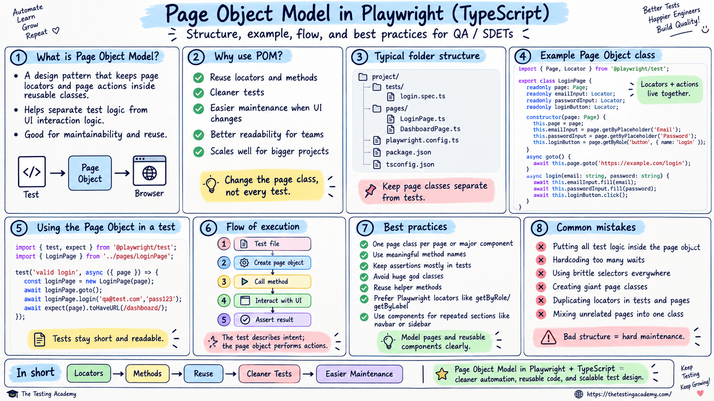
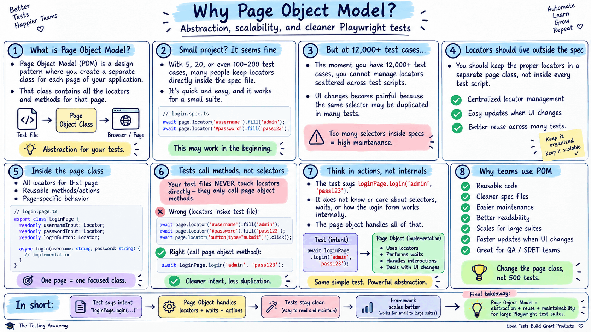
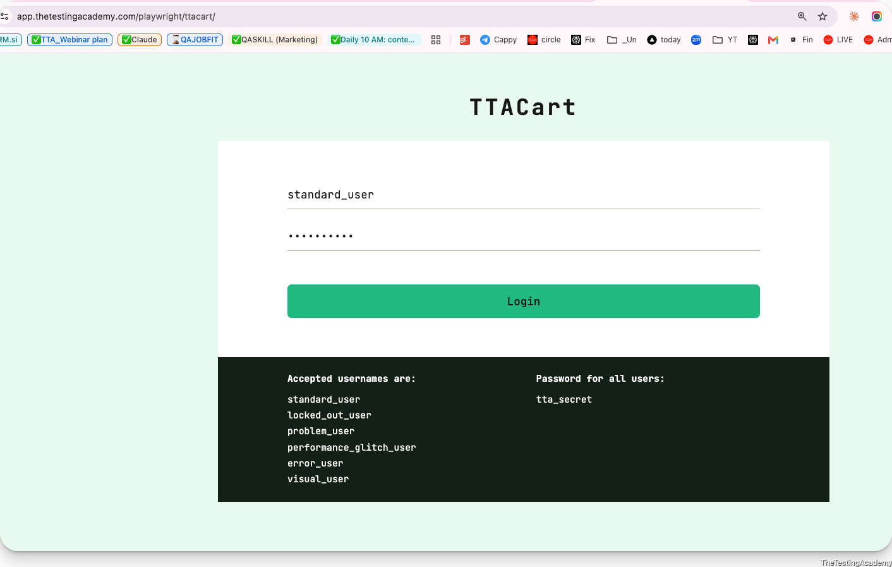
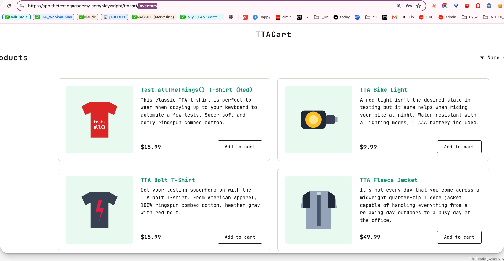

# Page Object Model



=




---

## Lets Implement the POM for this
 - [app.thetestingacademy.com/playwright/ttacart/](https://app.thetestingacademy.com/playwright/ttacart/) 

1. LoginPage
2. InventoryPage







---

LoginPage 

1. Page Locator
2. Page Actions


---

```
// Login
import { Page, Locator, expect } from '@playwright/test';

export class LoginPage {
    // Page Locators
    readonly page: Page;
    readonly emailInput: Locator;
    readonly passwordInput: Locator;
    readonly loginButton: Locator;

    constructor(page: Page) {
        this.page = page;
        this.emailInput = page.getByRole("textbox", { name: "Username" });
        this.passwordInput = page.getByRole("textbox", { name: "Password" })
        this.loginButton = page.getByTestId("login-button").or(page.getByText("Login")).or(page.locator("#login-button"));
    }

    // Page Actions
    async goto() {
        await this.page.goto('https://app.thetestingacademy.com/playwright/ttacart/');
    }

    async login(username: string, password: string) {
        await this.emailInput.fill(username);
        await this.passwordInput.fill(password);
        await this.loginButton.click();
    }


}
```
```
import { test, expect } from '@playwright/test';
import { LoginPage } from './pages/LoginPage';

test.describe('POM with Login Page Simple', () => {
    test('Login with valid credns', async ({ page }) => {

            const loginPage = new LoginPage(page);
            await loginPage.goto();
            await loginPage.login("standard_user","tta_secret");
            await expect(page).toHaveTitle("TTACart - Login");

    });
});
```
```
import { test, expect } from '@playwright/test';
import { LoginPage } from './pages/LoginPage';
import { Inventorypage } from './pages/InventoryPage';
import { Cartpage } from './pages/CartPage';
import { shot } from '../../utils/stepScreenshot';

// This app tags elements with data-test, not Playwright's default data-testid.
test.use({ testIdAttribute: 'data-test' });

test('add first item to cart and verify it in the cart', async ({ page }) => {
    const loginPage = new LoginPage(page);
    const inventoryPage = new Inventorypage(page);
    const cartPage = new Cartpage(page);
    let itemName = '';

    await test.step('open the login page', async () => {
        await loginPage.goto();
        await shot(page, 0, 'login page');
    });

    await test.step('login as standard_user', async () => {
        await loginPage.login('standard_user', 'tta_secret');
        await expect(inventoryPage.title).toHaveText('Products');
        await shot(page, 1, 'inventory');
    });

    await test.step('add the first item to the cart', async () => {
        itemName = await inventoryPage.addFirstItemToCart();
        await shot(page, 2, 'item added');
    });

    await test.step('open the cart', async () => {
        await inventoryPage.openCart();
        await expect(cartPage.title).toHaveText('Your Cart');
        await shot(page, 3, 'cart');
    });

    await test.step('verify the item is in the cart', async () => {
        await expect(cartPage.itemName).toHaveText(itemName);
        await expect(cartPage.checkout).toBeVisible();
        await shot(page, 4, 'verified');
    });
});
```


- Gaint Calss - POM
- Weak locator will break the full automation
- sometime - Abstraction too much 
    - loginPage -> footer, header, body -> body -> div page......
